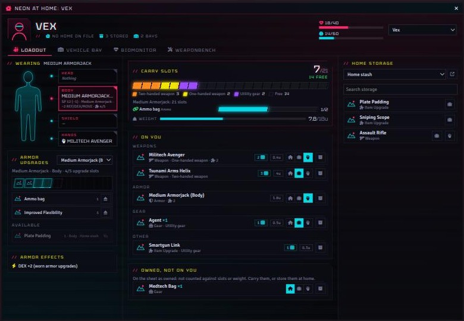
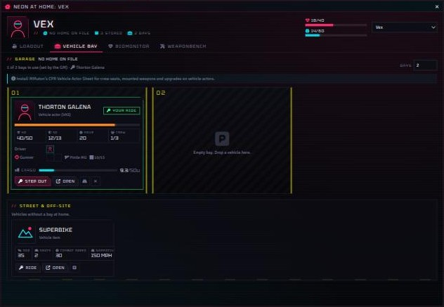

# Neon At Home: Loadout, Vehicle Bay, Weaponbench, Maintenance, Downtime & Biomonitor for Cyberpunk RED

A home suite for each character in **Cyberpunk RED - CORE** on Foundry VTT: one window, opened
from the character sheet, with a tab for each part of their home, and the **Biomonitor** in a
window of its own. Players reach their home whenever they like; what's done at home (the stash,
the workbench, the garage, maintenance) can wait for **downtime**.

- **Loadout.** What the character wears and carries, against the carry slots their armor gives
  them (the *Armor & Carrying 2.0* homebrew), plus a weight limit. Equip, carry or store things,
  move them to and from a **home stash**, and fit **armor upgrades**.
- **Vehicle Bay.** Their vehicles parked in the home's bays: HP, SP, speed, crew seats, mounted
  weapons, upgrades and cargo. Bays come from the home's parking in Neon Hub.
- **Biomonitor** (its own window). HP and wounds, armor, critical injuries, the cyberware
  monitor, Humanity and Empathy, and the *Syndromes & Inspiration* homebrew: Empathy tiers,
  Syndromes and their Stressors, Catharsis, Antipathy, In The System and Inspiration.
- **Weaponbench.** A weapon's attachment slots, what each attachment does to it, and attaching
  and detaching them, including custom attachments.
- **Maintenance.** R. Talsorian's *Breaking Your Stuff* DLC: what the character's Lifestyle
  maintains, monthly maintenance Checks for the rest, Damaged, Destroyed and Destroyed Beyond
  Repair gear, inspections, repairs, jury rigs, and malfunctions from the DLC's tables (on a GM's
  call or a natural 1 with poorly maintained gear).
- **Downtime.** Spend downtime (Neon Hub's downtime credits) on the core rulebook's downtime
  actions: the Hustle, rest, treating injuries, maintenance and repairs, and each Role's work
  (fabricating, upgrading and inventing, pharmaceuticals and therapy, rumors and stories, Night
  Markets). Salvaging from R. Talsorian's *Salvaging Night City* DLC, in 2045 or a 2070 version.
  Maker work is paid for in **Tech Materials** items, salvaged, stripped from gear, or sourced.

| Requirement | Version |
| --- | --- |
| Foundry VTT | v12 (built with v13+ APIs in mind) |
| Cyberpunk RED - CORE | 0.92 (checked against the 0.92.4 source) |
| [Neon Hub](https://github.com/choccoops/neonredlanding) | optional: vehicle bays from the character's home or household |
| [MMuton's CPR Vehicle Actor Sheet](https://github.com/MMuton/MMutons-Cyberpunk-Vehicle-Actor-Sheet) | optional: crew seats, mounted weapons and upgrades on vehicle actors |
| [MMuton's CPR Weight System](https://github.com/MMuton/MMutons-Cyberpunk-Red-Weight-System) | optional: item weights set there are used here |
| [Item Piles](https://foundryvtt.com/packages/item-piles) | optional: what a lost hand (or a malfunction) drops lands in a pile beside the token |



It shares Neon Hub's look: black chrome, notched corners, `//` labels and the Tektur typeface.

## Install

In Foundry's **Install Module** window, paste this manifest URL:

```
https://github.com/choccoops/neonathome/releases/latest/download/module.json
```

Enable **Neon At Home** in your world. Updates come through Foundry's module updater.

## Opening it

- The **Home** and **Biomonitor** buttons in a character sheet's header (owners and the GM).
- The **Home** and **Biomonitor** buttons at the top of the Actors sidebar.
- The house button in the Token Controls toolbar.
- **Go home** on the chat card players get when downtime starts.
- A macro, or a Neon Hub page button running one: `game.modules.get("cpr-neon-at-home").api.open()`
  (or `.biomonitor()`).

Players see their own characters; the GM can pick anyone from the list in the header.

## Loadout

The middle column is everything on the character: the **carry slots** they're using, shown as a
bar with a tick per slot, filled by kind with a key of what uses them and what's free, any bonus slots (holster, ammo bag), the **weight** bar, and each item with
its slot cost, weight and an owned / carried / equipped switch. Items the sheet marks *owned* are
not on the character (that's what *owned* means in Cyberpunk RED) and sit on their own shelf,
uncounted, until they're carried or stored.

On the right is **home storage**: the character's stash, or a vehicle's cargo. **Set up a home
stash** makes a Cyberpunk RED container actor (in a *Home Stashes* folder, owned by the
character's players). Drag items between columns, or use the buttons: store, take, take and
equip. Stacks ask how many. Weapons go with their attachments and loaded ammo the way Cyberpunk
RED moves items between sheets. When a player doesn't own the stash or a vehicle, the GM's client
does the move for them (a GM has to be online). The GM can drop any container actor on the
storage column to use it as that character's stash.

On the left, the character's **armor, shield, weapons in hand and worn gear**. Click a piece of
armor to see its **upgrade slots** and fit upgrades from the character or the stash.

### Carry slots (Armor & Carrying 2.0)

The armor worn on the body sets the carry slots:

| Armor | Carry slots | Upgrade slots |
| --- | --- | --- |
| Unarmored / Mimic Kit | 10 | — |
| Light Armorjack | 15 | 4 |
| Medium Armorjack | 21 | 5 |
| Heavy Armorjack | 25 | 6 |
| Flak | 30 | 8 |
| Metal Gear | 42 | 10 |
| Shield | — | 4 |

What things cost:

| Kind | Slots |
| --- | --- |
| Heavy weapons, machine guns (Heavy Weapons skill, grenade and rocket launchers) | 4 |
| Two-handed weapons | 3 |
| One-handed weapons | 2 |
| Ammo, utility gear | 1 |
| Spare armor carried, not worn | 3 |

Worn armor and clothing, installed cyberware, attachments and Neon Hub lifestyle items (rent,
packages, memberships) cost nothing; lifestyle items are left out of the Loadout altogether. Armor is classed by
name (*Light Armorjack*, *Flak*, *Metalgear*...), else by its SP; the GM can set the class, the
slot kind or the slot cost on any item (see *Item settings* below).

The **Neon At Home: Carry Gear** compendium has the External Gear sheet's items: the
**Shoulder Holster** (4 slots for pistols and 2 for pistol ammo, no armor), **Weapon Sling**
(3 slots for a two-handed weapon, no armor), **Carryall Bag** (+10 slots), and the **Trench Coat**
and **Armored Trench Coat**. Only one holster and one sling count at a time.

Each **Subdermal Pocket** installed as cyberware adds 2 bonus slots for gear or a one-handed
weapon, shown like a Gear bag; two pockets give two. No other cyberware gives slots. The GM can
change a pocket's slots in its item settings.

**Carry slots are a hard limit.** Carrying or equipping something that would go past them, in the
Loadout or with the character sheet's equip toggle, is stopped with a pop-up saying what doesn't
fit; the GM's pop-up has *Carry it anyway*. Things arriving on the character (bought, looted,
dropped on the sheet) are never refused, so nothing paid for is lost: the pop-up just says they're
over. Storing things or marking them owned is always allowed. The GM can relax the limit to a
warning, or switch it off, in the module settings.

### Armor upgrades

The **Neon At Home: Armor Upgrades** compendium has every upgrade from the spreadsheet, each
limited to the armor classes that list it and to the body, head or shield. The Neuro-port goes in
before the AI Armor Interface; the two ACPA versions take a Cyberware option slot instead.
Fitting one sets the armor's upgrade slots from its class, then installs it through Cyberpunk RED.

While the armor is worn, Neon At Home keeps an effect on the character, *Neon At Home: armor
fit*, for what the upgrades do: Improved Flexibility and Reflexes cancel the armor penalty on DEX
and REF rolls, Plate Padding gives +2 Stealth, the AI Armor Interface +2 Concentration, and War
Paint on both head and body +2 Wardrobe & Style. The rest (Improved Mobility, Enviro-Shielding,
Fireproof Padding, the Neuro-port, Rocket Boosters...) are listed on the Loadout for the table.
The GM can turn the effect off.

### Weight

Modelled on MMuton's Weight System: a limit of **BODY × 3** (or a fixed number), equipped weapons
and armor weigh a third, worn clothes and installed cyberware nothing, attachments add to the
weapon they're on, and cyberware (or worn gear) set to *add to weight limit* raises it. Each item
can have its own weight; otherwise Neon At Home uses MMuton's weight if that module set one, then
a default for the item's type. All of it is in **Carry & Weight Rules** in the module settings.

**Encumbrance.** Over the weight limit, MOVE is **halved** (rounded down, at least 1); over double
the limit, MOVE is **1** and the GM may call for checks depending on the situation. It's a status
effect, **Encumbered** or **Overloaded**, shown on the token, that comes and goes with the load and
is applied after other effects such as cyberlegs, so walking and running speed follow it. The
player and the GM are told in chat when it starts, worsens or ends. The GM can turn it off in the
Weight rules, and choose whether going over weight is only shown, warned about, or blocked for
players.

Both statuses are also in the token HUD, so the GM can place one by hand (it carries the MOVE
penalty too); a status placed by hand is left alone by the automatic check.

**Condition Lab & Triggler.** In Condition Lab, add conditions named **Encumbered** and
**Overloaded** (the names are module settings; the icons are `modules/cpr-neon-at-home/assets/
encumbered.svg` and `overloaded.svg`). Neon At Home then applies and removes those conditions
through CLT instead of its own statuses, so their macros, chat output and Triggler triggers run,
and it adds the MOVE penalty to whatever the condition already does. Without CLT, or without
those conditions, it uses its own statuses. If CLT is set to remove Foundry's default status
effects, the two statuses won't be in the token HUD, but they still show on the token.

## Vehicle Bay



The garage shows one bay per parking space at the character's home: the parking of their active
Neon Hub housing item, or of the Neon Hub household they live in. The GM can set the number on
the character (the field at the top right), and set a default for characters without a home.

Add vehicles by dropping vehicle actors from the sidebar onto a bay or the street, or with the
**Add vehicle** list. Cyberpunk RED vehicle items on the character show up by themselves. Drag
vehicles between bays (swapping), out to the street, or back. **Ride** marks the one the
character is using.

On [MMuton's Vehicle Actor Sheet](https://github.com/MMuton/MMutons-Cyberpunk-Vehicle-Actor-Sheet),
a vehicle shows its HP, SP, MOVE, its seats with who's in them and what weapons they control,
bulletproof glass, mounted upgrades and critical injuries; **Open** opens its sheet. Vehicle
actors also appear as storage in the Loadout, with a cargo weight limit (the rules' default, or a
vehicle's own `flags.cpr-neon-at-home.cargo`, or MMuton's per-vehicle capacity).

## Biomonitor

The Biomonitor has a window of its own (it isn't part of the home, and downtime doesn't hold it
back): the **Biomonitor** button on the character sheet or in the Actors sidebar.

The left side is the body: a heartbeat that speeds up as wounds get worse, the HP bar with the
Seriously Wounded mark, armor SP, and a **trauma map**. Each critical injury is marked where it
is on the figure (eyes, ears, jaw, throat, skull, lungs, ribs, spine, arms, hands, legs); markers
grow and redden as injuries stack at one spot, lost limbs are blacked out, and lost eyes and ears
are crossed out. Paired parts take a side, which the injury list can flip. The trauma level
(Stable, Injured, Critical, Failing) comes from how many injuries there are and how many raise
the Death Save, and the scan reddens and flickers as it climbs. Each injury lists its quick fix
and treatment.

The right side is the mind: Humanity against its maximum (with 30, 20 and 10 marked), EMP, and
the **Syndromes & Inspiration** homebrew (the GM can turn it off):

| Tier | Humanity | Picks | Stays at 30+ | Antipathy | Catharsis |
| --- | --- | --- | --- | --- | --- |
| Functional | 30+ | — | — | — | — |
| Borderline dissociative (EMP 2) | 20–29 | 1 Mild | — | — | +8 |
| Borderline cyberpsychosis (EMP 1) | 10–19 | Upgrade the Mild or add a Mild, and add a Severe | 1 Mild | yes | +10 |
| Cyberpsychosis (EMP 0) | 1–9 | Upgrade or add a Severe, and add an Extreme | 1 Severe | yes | +12 |
| Extreme | 0 or less | Every Syndrome at its worst | 1 Extreme | yes | — |

- **Syndromes** are picked from the homebrew's thirteen (with their variants, like Paralogic
  Confabulation's NET Warrior or The Knight), from the GM's own list, or written up as custom.
  Each shows its Stressors. A Syndrome belongs to the tier it was picked at: it goes **dormant**
  when the character climbs above it and comes back if they fall again. The Biomonitor says when
  the current tier still needs picks, and once the character is functional again, which one stays
  as a **scar**.
- **Catharsis** is gained each time Humanity falls into a deeper tier, and (if the GM keeps that
  setting on) takes Humanity Loss before true Humanity does, with a note in the Humanity ledger.
  The GM is told in chat.
- **Antipathy**, **In The System** and a **complete break** are shown as badges.
- **Inspiration** is awarded by the GM and spent by the player on a reroll, a loot box roll or
  2 LUCK back (announced in chat).
- GM tools: In The System, a complete break regardless of Humanity, and **Intensive Therapy**
  (removes the lingering Syndromes and resets the scars).

### Cyberware monitor

The **Cyberware** switch at the top of the Biomonitor shows what's installed in the body, by type
and in the character sheet's order: each foundational piece (Neural Link, Cybereye, Cyberarm,
Cyberleg, Cyberaudio Suite, borgware mounts) and built-in container (Internal, External,
Fashionware) with its option slots as sockets (used and total, counting slot upgrades), and the
cyberware installed in it, nested. The scan marks each piece on the body and draws cyberlimbs in
chrome.

The GM sets each piece's condition from *Breaking Your Stuff*: **working**, **Damaged**,
**Destroyed** or **Destroyed Beyond Repair**, and can knock it out with **EMP** (players see it but
can't change it; Damaged can be kept from them). Damaged cyberware still works but can malfunction.
Destroyed or EMP'd cyberware is non-functional, and takes everything installed in it offline too:

- it shows orange (Damaged), flickers yellow (EMP), red (Destroyed) or dead grey (Beyond Repair)
  on the scan and in the list; EMP wears off after a minute of game time (Cyberpunk RED p.345), or
  when the GM brings it back;
- its bonuses (Active Effects) switch off until it works again;
- its weapons can't be rolled from the character sheet (a warning says why);
- an offline **cyberarm or cyberleg** counts as a lost limb: the character gets Cyberpunk RED's
  **Dismembered Arm** or **Dismembered Leg** critical injury (from the core compendium, with its
  effects, e.g. -6 MOVE for a leg), named for the cause, e.g. "Dismembered Arm (Destroyed
  Cyberarm)", and on the right side of the trauma map. It goes away by itself when the limb works
  again or is uninstalled. It doesn't raise the Death Save penalty, since nothing was actually cut
  off. Meat limbs aren't affected. A lost arm also drops what its hand was holding (see
  [Maintenance](#maintenance)).

The player and GM are told in chat. Maintaining, inspecting and repairing it is done from the
Maintenance tab.

## Weaponbench

Pick a weapon from the rack. The bench shows its attachment slots as sockets, its numbers before
and after attachments (attack, damage, ROF, magazine, slots, worked out as Cyberpunk RED does),
and what each attachment does: its modifiers, an underbarrel weapon, its Active Effects and any
custom lines. The drawer lists the attachments that fit, from the character and their stash
(those are brought over when attached). Drag them onto the bench, or drag one off. Attachments
marked **fixed** stay on.

**Custom attachment** makes a new attachment item: name, slots, modifiers (added or set), and
free-text benefits. Players can make their own if the GM allows it.

## Maintenance

Rules from R. Talsorian's free **Breaking Your Stuff** DLC (v1.1), which you'll want to read. The
tab lists everything the character owns that needs looking after, grouped by kind, with each
weapon's attachments, each armor's upgrades and each cyberlimb's options as their own entries
(they're maintained separately).

**Each item on its own.** What a character's gear is worth in total doesn't matter: each item is
checked against its own price, so a pile of cheap gear never needs a better Lifestyle. **The home
stash** counts too ("anything you own"): its gear is listed under *In the home stash*, covered by
the character's Lifestyle and Role and due on their Rent Day, and worked on at home (the GM's
downtime settings for the stash and for maintenance both apply).

**Lifestyle.** Gear is maintained as part of your Lifestyle when the Lifestyle is good enough for
its value: Kibble covers gear under 500eb, Generic Prepak under 1,000eb, Good Prepak under
5,000eb, Fresh Food everything (drones and vehicles: 20,000 / 50,000 / 100,000eb). The Lifestyle is
read from the character's active **Neon Hub** lifestyle package, in either era (the 2045 packages,
their "+" versions, and the 2070 PrePaks), otherwise from the character sheet's Lifestyle; the GM
can set it by hand.

**Roles.** Techs count their Lifestyle a level higher for any gear, Solos and Lawmen for weapons and
armor, Netrunners for cyberdecks, bodyweight suits and VR goggles, Medias for cameras and
microphones, Rockerboys for instruments, microphones and amps. Gear an Exec's employer, a Medtech's
Role Ability or a Nomad's family looks after can be marked so in its item settings.

**Maintenance Checks.** Anything pricier than the Lifestyle covers needs a Check each month: the
skill for its kind (Basic Tech, Cybertech, Electronics/Security Tech, Weaponstech, or the vehicle
Tech skills) against DV13, 15, 17 or 21 by value. It's rolled with Cyberpunk RED's own skill roll
(dialog, LUCK, modifiers, criticals) and anyone can do the work: pick who in **Who works on it**. A
success maintains it for the month, removes the Damaged condition and ends any malfunction; a
failure means starting over. Wear pips show months without maintenance.

**Months and Rent Day.** With **Neon Hub**, maintenance months follow its calendar: each
character's month is their calendar's rent month, starting on its **Rent Day** just as their
Lifestyle bill does (characters on different calendars keep their own months). When a calendar
passes Rent Day, gear beyond the Lifestyle falls due again, and the players on that calendar and the
GM get one card listing which player characters have what to maintain (the GM's NPCs aren't
listed, and a calendar with no player characters posts nothing). The tab shows the rent month and the days to the next
Rent Day, and the GM can jump the calendar there (**To Rent Day**; Neon Hub then runs its own Rent
Day too: bills, Headquarters). Without calendars, Neon Hub's month counter keeps the months. Without
Neon Hub, or if the GM prefers, the GM starts each month (or each week) from the tab with **New
month**. Switching between them doesn't confuse old records: gear maintained under one way of
counting is simply due under the other.

**Conditions.** Damaged gear works but can malfunction; Destroyed gear doesn't work until it's
repaired (its effects switch off, its rolls are stopped, and Destroyed armor comes off and can't be
worn); Destroyed Beyond Repair never works again. The GM sets them on the workbench or with
**Break gear**, which picks the gear a cause usually affects (lack of maintenance, a Critical
Injury, electrocution, the environment, 20+ damage, fire or radiation, drugs). Damaged gear isn't
always obvious: the GM can keep it quiet, and a DV13 **Inspect** finds it. **Repair** fixes Destroyed
gear against a DV the GM confirms. The bench also shows what it sells for in its condition.

**Malfunctions.** Each kind of gear has its 1d6 table: armor, cyberdecks, cyberlimbs, cyberaudio and
optics, internal/external/fashionware, neuralware, drones, general gear and electronics, linear
frames and cyberchairs, vehicles, weapons. The GM rolls one from the bench (or picks the table), and
by default one is rolled automatically when an attack or other roll with a **Damaged** item comes up
a natural 1. The malfunction stays on the item for as long as it lasts (by world time), and a Tech
with Field Expertise can **jury-rig** it for 10 minutes per point. The card's button does what Neon
At Home can: drop the weapon, empty the magazine, mark the item Destroyed...

The malfunction text is a short summary written for this module, with the DLC's page; the DLC has
the full wording. The **Malfunction Tables** compendium has all eleven tables: import one into your
world and edit it (for instance with the DLC's own text) and Neon At Home rolls from your copy.

**Dropping things.** A **Dismembered Arm** or **Hand**, from Cyberpunk RED's critical injuries or
an offline cyberarm, drops what that hand held: two-handed weapons always (one arm can't hold
them), everything if both arms are gone, and the GM is asked about one-handed items (and which arm,
if that isn't known). With **Item Piles** on, dropped items land in a pile beside the token, with
their attachments, which go back on when someone picks the item up, and the pile goes once it's
empty; without it, they're simply no longer carried. Item Piles needs its System Specific settings
for Cyberpunk RED (an actor class type, and `system.amount` as the item quantity attribute): Neon At
Home says so when they're missing.

**Lost limbs and their cyberware.** A Dismembered Arm, Hand or Leg asks the GM which side was
lost, and what comes off with it drops too (in the same pile): a cyberarm with every option in it,
or a hand's cyberhand, cyberfingers and other hand options, or a cyberleg with its feet; the options
in a meat limb, and a glove on a lost hand, go as well. The GM can untick anything. Torn off, the cyberware is Destroyed until it's repaired with
Cybertech (Cyberpunk RED p.226); a cyberarm picked up again comes with its options installed. On a
cyberlimb, the injury notes that Cybertech can Quick Fix or Treat it (p.223).

**Holding things with a lost hand.** With an arm or hand gone, a character has one hand left:
equipping a two-handed weapon, or another weapon or shield when that hand is full, is stopped with
a pop-up (the GM can equip it anyway). With both gone, nothing can be held.

## Downtime

**Downtime** is when the crew can go home: Neon Hub's downtime (the GM calls it, with time for
each character taking part to spend), or, without Neon Hub, the GM's **Start downtime** switch on
the Downtime tab (untimed). The home's header shows whether a character is in downtime and how
much time they have left.

**What waits for downtime.** Players can open their home any time and look at everything; the GM
decides, in the module settings, what's only done in downtime (all of these by default, and never
for the GM):

- the **home stash** (taking things out, putting things in, upgrades from it);
- the **Weaponbench and armor upgrades** (attaching, detaching, custom attachments, fitting armor
  upgrades);
- the **Vehicle Bay** (parking, swapping, adding and removing vehicles);
- **maintenance and repairs**, which also spend the time they take.

When downtime starts, the players taking part get a card with a **Go home** button.

**The Downtime tab.** Each action shows what it takes (time, DV, materials, the roll) and spends
the character's downtime: with Neon Hub, into its downtime log (the tab shows this downtime's log,
and the time is given back if a roll is cancelled). Rolls are Cyberpunk RED's own skill rolls, with
its dialog, LUCK and modifiers. A Medtech's materials come out of the character's eurobucks, in the
wealth ledger; a Tech's are **Tech Materials** items (below). Role actions appear only for the character's Roles (from the role items on their sheet).

| Who | Action | What it takes (Cyberpunk RED core rulebook) |
| --- | --- | --- |
| Anyone | **The Hustle** | A week; 1d6 on the Role's table, paid by Role Ability Rank (p.381) |
| Anyone | **Rest and recover** | Days of rest, BODY HP a day (p.222) |
| Anyone | **Treat a critical injury** | Four hours; the injury's skill and DV (Cybertech on a cyberlimb); not on yourself (pp.222-223) |
| Anyone | **Salvage** | A week; Basic Tech sets the worth found; picked out as Destroyed items or Tech Materials (*Salvaging Night City*) |
| Anyone | **Maintenance and repairs** | What's due, and repair projects for what's Destroyed (p.140) |
| Anyone | **Projects** | Maker work and repairs under way, with their meters |
| Tech | **Fabricate** (a project) | Drop an item in: its DV and time by price, materials a category lower, + Fabrication Expertise (p.148) |
| Tech | **Upgrade** (a project) | One per item; slots, concealable, Excellent Quality and +1 SP are applied, the rest noted (p.148) |
| Tech | **Invent** (a project) | Described for the GM, who sets its price category, which sets the DV and time (pp.148-149) |
| Tech | **Strip for parts** | Gear broken down into Tech Materials, several items' worth toward one tier |
| Medtech | **Synthesize pharmaceuticals** | An hour, DV13 Medical Tech, 200eb: doses equal to the skill (p.149) |
| Medtech | **Therapy** | A week for both; Addiction, or Standard/Extreme Humanity Loss (2d6/4d6 Humanity) (p.229) |
| Media | **Chase a rumor** | An information skill against the Active DV (p.151) |
| Media | **Publish a story** | 1d10 against Believability, by Credibility and evidence (pp.151-153) |
| Fixer | **Set up a Night Market** | Operator Rank 5, once a month (p.160) |

**Projects.** Maker work and repairs can take a week, two, a month or more, so they're projects,
kept on the character and carried over from one downtime to the next. The corebook gives them all
the same failure: halfway through, the Tech realizes they have to start over (pp.140, 148-149). So:

- Starting one uses its Tech Materials (Maker work). Each project has a meter with the halfway mark.
- Downtime is put into the meter in any amount: all it needs, up to the check, an hour, a day, a
  week, or exactly as much as the player picks on the project's slider (or types in hours). Starting
  a project can put in any amount too, or nothing yet. Time goes in up to the halfway mark first.
- At the halfway mark, the check comes up: Cyberpunk RED's roll for the project's skill, with the
  Expertise rank (Field Expertise for a Tech's repair).
  - **Failed**: the meter empties and it starts over. The materials are fine (not used again).
  - **Passed**: the rest of the time can go in.
- A full meter finishes it: the item is made, the upgrade applied, the invention written up, or the
  repaired item works again.
- A cancelled roll leaves the check due (**Roll the check** on the project). Projects can be
  abandoned; what's been spent stays spent.

Repairs are started from the Maintenance tab's **Repair** or the Downtime tab's workshop, by
whoever does the work (anyone with the skill).

**Tech Materials.** Maker work isn't paid for in eurobucks but in items: **Cheap** through **Super
Luxury Tech Materials**, one item per price category, in the *Neon At Home: Tech Materials*
compendium. Fabrication takes materials a category below the item (a Super Luxury item, half its
price in Super Luxury units), an Upgrade the item's own category (a vehicle's, Very Expensive)
(p.148). They're used when the project starts, oldest first, and the start card lists where they
came from. Each materials item's description says where it came from (*Salvaged from: ...*), so the
GM can keep the books: hand them out or sell them from the compendium and fill that line in, or
let the character get them by:

- **Salvaging**: a haul's worth can be picked out as materials of any category it covers.
- **Stripping for parts** (Techs): tick items whose worth adds up to the materials wanted, of any
  mix of prices (a Heavy Pistol, a Radio Scanner and two Flashlights toward a Premium unit). Damaged
  gear is worth a category less, Destroyed two, Destroyed Beyond Repair nothing (*Breaking Your
  Stuff*). Stacks of materials break down or combine the same way (an Expensive unit into five
  Premium). What's past the materials' worth is lost. Gear that's equipped, installed, or holding
  installed items can't be stripped.

**Salvaging** (R. Talsorian's *Salvaging Night City* DLC). A week picking through the ruins,
and no other downtime that week. Take whatever turns up (1d6 on the place's category table) or hunt
one category at a harder DV. A Basic Tech Check sets the worth found (DV9 for 10eb up to DV29 for
1,000eb; hunting a category, DV13 up to DV29 for 500eb). The haul waits on the character in the
Salvage panel, to be picked out up to its worth: **Destroyed** items of its category, dropped in
from the sidebar or a compendium (to be repaired, p.140), or Tech Materials. Leaving the rest loses
it. A Critical Failure finds nothing and rolls the place's **Perils of Salvaging**: the card rolls
the damage (6d6 armor soaks, radiation by the round, toxic gas to resist), names gear that keeps it
off (a Radiation Suit, an Anti-Smog Breathing Mask, a Grapple Gun or Hand), and a collapse draws a
Critical Injury to the Body from Cyberpunk RED's own tables.

- **2045**: the DLC's places (the Hot Zone, a Combat Zone, the Scrapyards, the Perimeter), all
  rolling the DLC's tables.
- **2070** (the Night City of the *Edgerunner's Handbook*): one Combat Zone, in Pacifica, and no
  Hot Zone. **The Combat Zone** (Pacifica's dead resorts, the Voodoo Boys, BARGHEST's Dogtown, scavs)
  turns up more weapons and chrome; **the Scrapyards** (Coronado Dam's dump in Santo Domingo,
  Northside's gutted factories) mostly general gear and old decks; **the Perimeter** and **the
  Badlands** weapons and armor, with raiders, Nomads, old war leftovers and the desert for perils.

The era follows Neon Hub's lifestyle era, or the **Salvage tables** setting. The tables are
summaries in Neon At Home's own words (the 2070 ones are Neon At Home's own); the *Neon At Home:
Salvage Tables* compendium has them all as roll tables: import one and edit it, and Neon At Home
uses your wording (a category table's results can be renamed to other categories).

Other Roles' abilities aren't downtime work; they Hustle. A Tech also adds Field Expertise to
maintenance, inspection and repair checks (p.147). The corebook doesn't say how long chasing a
rumor or writing a story takes; the player sets it (a day by default).

## Item settings (GM)

Every item sheet has a **Home** button for the GM, with Neon At Home's settings for that item:

- slot kind and cost, weight, and how much it adds to the weight limit;
- armor class (armor);
- bonus carry slots, *no armor* and *one per group* (carry gear like holsters and bags);
- where an armor upgrade fits, which classes, built-in effects, what it requires, bonus slots;
- benefit lines and *fixed* (weapon attachments);
- maintenance: what kind of gear it is, its malfunction table, and who looks after it.

## Module settings

- **Carry & Weight Rules**: the carry slots per armor class, upgrade slots, slot costs, the weight
  limit and default weights, and your own Syndromes. Each table shows the spreadsheet's numbers
  and can be put back to them.
- **Carry slots**: a hard limit with a pop-up (the default; the GM can override), a warning, or off.
- **Weight limit**: show only, warn, or block players (encumbrance applies either way).
- **Apply armor upgrade bonuses**, **Vehicle bays without a home**, **Players can make custom
  attachments**, **Syndromes & Inspiration**, **Catharsis takes Humanity Loss first**.
- **Maintenance tab**, **Maintenance months** (Neon Hub's Rent Day, or monthly or weekly started by
  the GM), **Malfunction on a natural 1** (Damaged gear, also gear a month overdue, or never),
  **Lost hands drop what they hold**, **Lost limbs drop their cyberware**.
- **Salvage tables**: 2045 or 2070, or Neon Hub's lifestyle era (automatic).
- **Downtime tab**, and what's only done in downtime: **Home stash**, **Weaponbench and armor
  upgrades**, **Vehicle Bay changes**, **Maintenance and repairs**.

## For macros and other modules

```js
const home = game.modules.get("cpr-neon-at-home").api;
home.open(actor, "bench");          // open a tab: loadout, bay, bench, maintenance, downtime
home.biomonitor(actor);             // open the Biomonitor window
home.downtime(actor);               // { active, source, label, total, spent, left } (minutes)
home.downtimeAction(actor, "rest", { days: 2 }); // do a downtime action (Maker work starts a project)
home.projects(actor);               // projects under way
home.workOnProject(actor, id, "all"); // put downtime in: "check", "all" or minutes
home.salvage(actor, { location: "badlands", category: "any" }); // a week of salvage
home.hauls(actor);                  // what salvage trips found, still to pick out
home.haulMaterials(actor, haulId, "premium"); // take Tech Materials out of a haul
home.stripForParts(actor, { [itemId]: 1 }, "premium", 1); // a Tech strips gear for materials
home.show("loadout");               // GM: open it on every player's screen
home.measure(actor);                // { carry, weight }
home.bays(actor);                   // { slots, source, homeName }
home.psyche(actor);                 // tier, Syndromes, Catharsis...
home.awardInspiration(actor, 1);    // GM
home.maintenance(actor);            // gear, what it needs, where it stands
home.malfunction(actor, itemId);    // roll a malfunction (optionally: , "weapon")
home.setCondition(actor, itemId, "damaged"); // GM: "", "damaged", "destroyed", "dbr"
home.maintenanceCycle(actor);       // their month: { scheme, n, label, next, calendar }
home.newMaintenanceCycle();         // GM: next month (or week), when not following Rent Day
home.drop(actor, itemId);           // drop it where they stand
home.registerFeature({ id, icon, label, template, prepare, actions }); // add a tab
```

New sub-features plug into the same window: see `scripts/apps/features.js`.

## Data

- Actor flags `cpr-neon-at-home.home` (stash, vehicles, bays) and `cpr-neon-at-home.psyche`
  (Syndromes, Catharsis, Inspiration).
- Item flag `cpr-neon-at-home.item` (the item settings above, plus condition, EMP, last
  maintained month and any malfunction). Actor flag `cpr-neon-at-home.maint` (the GM's Lifestyle
  for maintenance).
- Stashes are Cyberpunk RED container actors flagged `cpr-neon-at-home.stashOf`.
- Cyberpunk RED data it reads: equip state, armor locations, SP and penalty, installed items,
  upgrade modifiers, HP, wound state, Humanity, EMP, LUCK and critical injuries.

## Development

```bash
npm install
npm test             # rules, operations and template rendering against mock documents
npm run check        # syntax, JSON and localization keys
npm run preview      # render each tab to preview/ with a test character
npm run build:packs  # write the malfunction tables, then compile the compendiums from packs/_source
```

See [PUBLISHING.md](PUBLISHING.md) for releases.

## License

MIT. The Tektur font is under the SIL Open Font License (`fonts/Tektur-OFL.txt`).
Cyberpunk RED is a trademark of R. Talsorian Games; this is unofficial fan content.
